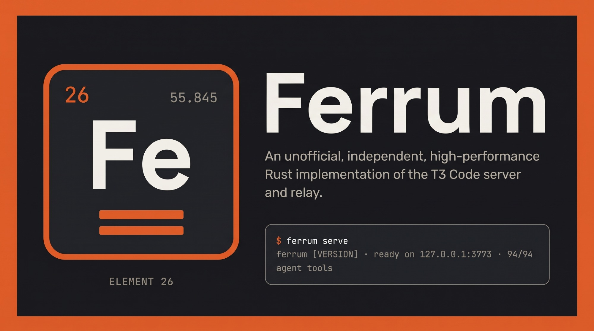

<p align="center">
  
</p>

# Ferrum

**An unofficial, independent, high-performance Rust implementation of the T3 Code server and relay.**

> [!WARNING]
> **Alpha-quality software under heavy development.** Do **not** use this for anything important. Expect breaking changes, incomplete features, and data loss.

**No affiliation:** Ferrum is an unofficial, independent Rust port of the headless [T3 Code](https://github.com/pingdotgg/t3code) server (`t3 serve`) and standalone relay. This project has **no affiliation with T3 Code or T3 Tools Inc., and is not endorsed by them in any way**. T3 Code is a product of T3 Tools Inc.

---

## Overview

Ferrum reimplements the TypeScript T3 Code environment server and standalone relay in Rust. Compatibility work targets one pinned upstream commit, named under [Parity status](#parity-status). At that commit the server declares 235 WebSocket RPC methods, 86 typed HTTP operations (including 30 relay operations), and 58 orchestration dispatch command types.

## What works now

Based on `main` and the parity test suites:

- **Codex and Claude Code agent turns:** Launching Codex and Claude Code sessions, streaming responses, tool calls, approvals (allow, allow for session, decline, `approval-required`, `auto-accept-edits`), and user-input / question requests. Each thread keeps its Claude CLI running across turns, and an instance's Codex turns share one app-server, as in the original. You can steer a running Codex, Claude or Grok turn with a text message.
- **Grok agent turns:** Grok turns run over ACP in the `grok agent stdio` process each thread keeps, streaming reasoning, replies and tool calls, with approvals in Grok's own runtime modes. Stop restarts the process, and the next turn loads the session again. Grok reaches T3's tools through a stdio MCP bridge (`acp-mcp-bridge`), and can run delegated tasks.
- **ACP Registry agent turns:** An ACP Registry agent runs turns in the reference's generic ACP flavor, from a local command or from the registry: a downloaded binary, or an npx or uvx package, is installed (or its install reused) and launched with its distribution's arguments and environment. Each thread keeps its agent, which also gets T3's MCP endpoint for the terminal fallback; Stop cancels the prompt (`session/cancel`) and the agent runs on for the next turn.
- **Pi agent turns:** Pi turns run over its RPC mode in the process each thread keeps, with the reference's extension (T3's tools, the runtime mode's approvals and the system prompt's instructions) written byte for byte and loaded with `--extension`. They stream thinking, replies and tool calls (a command's output as it runs), and settle once Pi is idle. Approvals go to the user, and a message can steer a running turn. Stop aborts the run and stops the process, and the next turn resumes Pi's session file.
- **OpenCode agent turns:** OpenCode 1.x turns run on an `opencode serve` each thread's session starts (or the configured server), with T3's MCP server registered and the runtime mode enforced as OpenCode permission rules. Prompts carry T3's instructions as their system text; the event stream's reasoning, replies and tool calls become items, and a turn settles once OpenCode reports the session idle after taking its prompt. Approvals and questions go to the user, a message can steer a running turn, and Stop aborts the session's run. The OpenCode session is the native thread, resumed by later sessions.
- **Antigravity agent turns:** Antigravity's `agy acp` runs turns over ACP in the reference's Antigravity flavor: launched as the driver launches it (the resolved executable, the instance's private profile and environment, a temporary folder per process), signed in eagerly, its session resumed with `session/resume`, and its mode kept to what agy accepts while T3 answers its requests from the thread's runtime mode. Its command calls show their command line, output and exit code; it reads files in the thread's folder through T3; its questions and approvals (with its labels) go to the user; from agy 1.5 a message steers the running turn; Stop cancels the prompt and the agent runs on.
- **Delegated tasks:** An agent can start a child task, wait for it or get its result delivered later, check its progress, cancel it, send a finished child a follow-up, run it in its own worktree or on a linked machine, and create new threads. Tasks recover after a restart, and a result can be delivered into the parent's running turn.
- **Thread titles:** Codex, Claude, Pi, Grok, OpenCode (1.x and 2) and Antigravity text generation models can title threads.
- **Scheduled tasks:** Agents can manage schedules, and due tasks start on their own.
- **Checkpoints, interrupts, and token usage:** Reference-compatible checkpoint naming, turn interrupts (including stopping spawned child processes), token usage reporting, model reporting, and usage-limit reset times.
- **Restart recovery:** Resuming and continuing interrupted turns, retries, rewinds, and background work after a server restart.
- **T3 Connect relay tunnel:** Provisioning, running, and releasing the T3 Connect managed tunnel, plus handing off an active tunnel cleanly across Rust/TypeScript switches.
- **Environment links (incoming):** Accepting environment links and pairing tokens issued by the TypeScript server on the same home directory, plus pairing-link administration. Sessions the TypeScript server signed in on the same home are listed under Connections and can be revoked there.
- **Environment links (outgoing):** Linking to another machine, listing and forgetting links (shared with the TypeScript server on the same home), forwarding MCP tool calls to a linked machine, and agents asking you to link one from inside a conversation (`t3_environment_link`), answered in a card.
- **MCP server and agent tools:** Serving MCP sign-in and the agent tools over `/mcp`, with the original's agent instructions and capabilities. 88 of the original's 94 agent tools are served, including reading pull requests and CI, issues, attachments, worktrees, previews, HTML pages, feedback, secret requests, and simulators and emulators on this machine. The [agent tool checklist](docs/agent-tools.md#checklist) tracks each tool.
- **Login-shell `PATH` discovery:** Reading the login shell's `PATH` at startup and again before source-control discovery, so provider CLIs and tools installed later are found; listing Codex models from its CLI.
- **Provider status checks:** Every built-in provider (Claude Code, Codex, Cursor, OpenCode, Grok, Pi, fx, Kiro, Antigravity and Muse Code) has its status (installed version, sign-in state, usage and models) checked at startup, on settings changes, every 5 minutes while a client is watching, and on refresh, and pushed to clients. The checks include newer CLI releases and Claude's skills, and Rust can redeem the reset credits a Claude or Codex subscription banks.
- **Configuration, auth, and desktop adoption:** Shared `userdata/` layout (`settings.json`, secrets, managed policy, `server-owner.sqlite` exclusive lock, `server-runtime.json`), browser session cookies, WebSocket tickets with DPoP checks, CORS, and desktop SSH launcher adoption.
- **Git, GitHub, and workspace operations:** File operations, terminals (PTY), git workflows, GitHub/Linear provider RPCs, Bitbucket pull requests with the credential from Settings or the `T3CODE_BITBUCKET_*` environment variables (listing them; opening one with its checks, activity and reviewers; merging, declining, editing, commenting, reviewing and resolving; its diff over HTTP), Chromium preview support, and the preview tunnel that carries other devices' preview traffic to this machine's local servers (with its setting and managed policy switch).
- **Split control/workspace architecture:** Out-of-process workspace execution via `t3-agentd` and an embeddable, `wasm32-unknown-unknown`-compatible control plane (`workers/`). Remote Codex and Claude turns can call the host's MCP endpoint as their thread. See [host configuration](docs/embedding.md#settings-and-provider-turns).
- **Parity test suites:** Automated suites comparing HTTP, WebSocket RPC, client initial sync, live provider turns, settings, auth, MCP, git/GitHub, previews, and relay behavior directly against the pinned TypeScript reference.

## What's still missing compared with the original

Most suites match the original exactly; the few expected differences are listed under [Parity status](#parity-status). The biggest remaining gaps are agent turns for providers other than Codex, Claude, Grok, ACP Registry agents, Pi, OpenCode 1.x and Antigravity, a handful of agent tools, and features that need the desktop app.

### Threads and history

- **Restarted Claude turns.** If a resumed Claude turn fails, its retry can be missing context from the failed attempt.
- **Live updates of tool calls.** The original merges a tool call's queued updates into one; Rust sends each of them, so a client receives one extra update per tool call (upstream #39502). Most of the [live-turn expected failures](scripts/client_thread_parity_xfail.json) are this.
- **Older databases.** Both servers can use the same current database. If a home has only the older TypeScript database, start the matching TypeScript server once to upgrade it. See the [shared database notes](docs/shared-store.md).

### Agents and tools

- **Pull request changes.** Agents can read pull requests and CI, but can't open, update, review, respond to or merge one, or re-run CI (`pull_request_create`, `pull_request_update`, `pull_request_review`, `pull_request_respond`, `pull_request_merge`, `ci_rerun`).
- **Devices.** Agents can use simulators and emulators on this machine, on SSH device hosts and from Simlock pools (alpha), and in Expo Simulators sessions (under the host's project, or the one the thread's app config names). Device detail and actions (settings, foreground app) work on this machine only.
- **Delegated tasks.** On the embeddable control plane a child can't run in its own worktree (`isolation: "worktree"`).
- **Previews and pages.** Recordings from a workspace on another machine, and the agent's cursor drawn into recordings, are missing.
- **Secrets in schedules.** A scheduled task can't use a secret yet, and the embeddable control plane stores no secrets.
- **Claude workflows.** Rust's Claude sessions run no workflow tasks.

### AI providers

- **Other providers' turns.** Only Codex, Claude Code, Grok, ACP Registry agents, Pi, OpenCode 1.x and Antigravity run agent turns. OpenCode 2, Cursor, fx, Kiro and Muse Code get status checks (and some of them thread titles), but can't run a turn yet. Rust installs and removes ACP Registry agents.
- **Grok extras.** Grok's questions (`ask_user_question`), plan-mode exit, background tasks and monitors, subagents, `$skill` mentions, context usage and session titles are not ported yet, and a Grok turn that a server restart cuts off mid-turn is not yet compared with the original.
- **ACP Registry extras.** The per-agent quirks of the reference's registry adapter are not ported: Copilot's and Command Code's MCP over HTTP, Devin's client terminals, Claude ACP's subagents and work state, Kimi's prompt-outcome watch, GLM's per-turn usage, Mistral Vibe's extensions, Hermes's post-settle continuation, and the elicitation forms of Droid, omp and OpenCode. So are agents that speak ACP protocol version 2, sign-in through a URL, session modes for plan mode, custom models, and the status probes the reference runs for an agent before its turns. A registry agent's turn on a remote workspace (through the control plane) cannot install it yet.
- **Pi extras.** Pi's extension questions (select, input and editor dialogs) are cancelled rather than asked, and its notices, extension errors, provider retries, `/compact`, service tier, `$skill` chips, subagents, steering status, rollback and workspace handoff are not ported yet. Neither is the path text a turn's non-image attachments add to its prompt.
- **OpenCode extras.** OpenCode 2's own adapter (its shared server, `/api` protocol and execution events) is not ported: its threads fail with a clear message. For 1.x, subagents (the `task` tool and child sessions), wakes from background work, todo lists, `/compact` and context-overflow recovery, native slash commands, MCP tool presentation, rollback and fork, the server ledger that reaps orphaned servers, and agent feedback instructions are not ported yet.
- **Antigravity extras.** agy's post-settle continuation (background commands, schedules and wakes that hold a turn open), its subagents and child work, the session-log check for upstream errors it reports as replies (quota, rate limits, invalid thinking signatures), the 15-minute inactivity watchdog, the read repair for its client file reads, edit diffs placed at their lines, payload bounds, refusing a runtime the manifest rates broken during a turn, native goals (`/goal`), and attachments other than images are not ported yet.
- **Steering extras.** A steering message that changes the model or carries attachments still behaves differently. Rust also lacks the original's "delivery not confirmed" notice, its handling of Claude's foreground subagents during a steer, and its follow-up turn when a provider refuses a steer.
- **Titles.** Cursor and Muse Code can't title threads yet. Custom title generators, images in an OpenCode title prompt, and titles that draw on a forked thread's history are missing. Antigravity titles don't yet clean up old temporary folders or wait out a sign-in.
- **Desktop power reports.** Rust doesn't receive the desktop app's power reports (battery, screen lock, heat), so it never pauses provider checks for them.

## Parity status

Parity is tested by running the original TypeScript server and the Rust server side by side and comparing what they answer. Each gets a fresh home directory, and both get the same fake provider CLIs that replay recorded Codex and Claude sessions and scripted ACP sessions (Grok, ACP Registry agents and Antigravity), Pi RPC sessions and OpenCode servers, and local stand-ins for every outside service. No test reaches the network or a real model.

- **Pinned reference:** [upstream commit `fd0331ca`](https://github.com/pingdotgg/t3code/tree/fd0331ca9b1596ed7018c80f52b7e6730014f593) (`fd0331ca9b1596ed7018c80f52b7e6730014f593`). This is the only place the README names it.
- **Suites:** 56 parity suites run in CI across 9 shards on every code change, and the whole set runs twice each night. 6 more run on their own.
- **Client calls:** the [client RPC suite](scripts/client_rpc_cases.json) drives 242 recorded client steps through the original client. None is expected to fail.
- **Live turns:** the client thread suite runs 155 provider scenarios. 73 checks are expected to fail, 19 of them races ([list](scripts/client_thread_parity_xfail.json)).
- **Shared home:** the server-switch suite has 1 expected failure ([list](scripts/shared_store_parity_xfail.json)).
- **Provider status:** the [provider status suite](scripts/provider_status_parity.py) has no expected failures.
- **Other suites:** none has a known difference.
- **Agent tools:** 88 of 94 served ([checklist](docs/agent-tools.md#checklist)).

A suite fails on any difference it doesn't list, and on any listed case that starts to match.

## Performance

Measured against the pinned reference on the same machine, with the same fake provider CLIs ([method and full results](docs/performance.md)), Ferrum installs about 3× smaller, starts about 17× faster (0.11 s against 1.85 s), uses about 11× less memory at idle (40 MiB against 452 MiB) and about 8.5× less under load, and runs 2–3× the fake turns per second with about a third of the CPU per turn. Most client RPCs answer 2–13× faster. `server.getConfig` is slower in Rust, and Rust uses a little more CPU while idle. CI measures again on every push to `main` and records the trend on the [`perf-data`](https://github.com/ttulttul/Ferrum/tree/perf-data) branch.

## Install and switching

From the repository root, use `./install` to temporarily replace a running standalone TypeScript server with the Rust build and restore it later:

```bash
./install --status     # Show the discovered server and switch state
./install --rust       # Build and start the Rust server in place
./install --original   # Stop Rust and restore the TypeScript server
```

How `./install --rust` works:
- Discovers the live server via `server-runtime.json`, verifies `GET /` answers 2xx, and saves the original command, environment, working directory, and T3 home under `${XDG_STATE_HOME:-~/.local/state}/ferrum-switch` (override the parent directory with `FERRUM_SWITCH_STATE`; a switch saved under the older `t3code-rust-switch` directory is still honored).
- Installs Rust via `rustup` if `cargo` is missing, builds a locked release binary, and starts `t3code-server` on the same host, port, and data directory.
- On Linux, stops, disables, and runtime-masks a discovered user `systemd` service while Rust is running; `./install --original` unmasks and restores it.
- Automatically restores the TypeScript server if the Rust server fails to start.
- Uses the reference update-restart marker (`runtime/desktop-update-restart`) on each switch so the T3 Connect managed tunnel is handed over immediately instead of reprovisioning.
- Logs at `info` by default (override with `RUST_LOG`) to `rust-server.log` in the switch state directory.

Notes and safety checks:
- Supports Linux and macOS.
- Run `./install --status` first on an unfamiliar machine, and quit the T3 desktop app before switching its server.
- Set `T3CODE_HOME` before running `./install` if your server uses a custom T3 home.
- Refuses to act if it finds multiple live servers, a stale or incomplete runtime record, an unidentifiable background service, a desktop-managed server, or a missing original binary/working directory.

## Build and run from source

```bash
cargo build --locked
target/debug/t3code-server --listen 127.0.0.1:3773 --data-dir .t3
```

### Bootstrap and configuration

- **Desktop bootstrap:** An environment launcher can pass the desktop bootstrap envelope on an inherited file descriptor with `--bootstrap-fd` (bind address, port, T3 home, and bootstrap credential). Exchange the credential at `POST /api/auth/browser-session` and send the resulting cookie to authenticated HTTP endpoints. For a standalone process, set `T3CODE_BOOTSTRAP_CREDENTIAL` to a high-entropy secret.
- **Directory layout and environment variables:** `T3CODE_HOME` and `--base-dir` select the base directory, with mutable files under `userdata/` (`settings.json`, `keybindings.json`, `themes`, `attachments`, `browser-artifacts`, `logs`, `secrets`, `environment-id`, `anonymous-id`, `server-runtime.json`). Standard variables (`T3CODE_HOST`, `T3CODE_PORT`, `T3CODE_MODE`, `T3CODE_NO_BROWSER`, `T3CODE_AUTO_BOOTSTRAP_PROJECT_FROM_CWD`, `T3CODE_LOG_WS_EVENTS`, `T3CODE_DEV_ALLOWED_ORIGINS`, `T3CODE_TAILSCALE_SERVE`, `T3CODE_TAILSCALE_SERVE_PORT`, `T3CODE_STATIC_DIR`) match the TypeScript server.
- **Exclusive ownership:** At startup, the server acquires an exclusive SQLite lock on `userdata/server-owner.sqlite` (waiting up to 250 ms) and exits with status `78` if another Rust or TypeScript server already owns the home directory. Once listening, it atomically writes `userdata/server-runtime.json` and removes it on `SIGINT`/`SIGTERM`.
- **Static client:** `GET /` serves the built web client from `--static-dir` / `T3CODE_STATIC_DIR` when set, or a placeholder page otherwise.

### WebSocket RPC

Connect to `/ws?orchestrationProtocol=2` with a session cookie or WebSocket ticket. Clients send Effect RPC messages as JSON text frames (string or numeric request IDs; add `frameParts` to the URL for >48 KiB frame chunking):

```json
{"_tag":"Request","id":"1","tag":"server.probe","payload":{},"headers":[]}
```

```json
{"_tag":"Exit","requestId":"1","exit":{"_tag":"Success","value":{}}}
```

### Standalone relay

Run the relay separately with `--relay`:

```bash
target/debug/t3code-server --relay --listen 127.0.0.1:3774 --data-dir .t3
```

Configure `RELAY_ISSUER` (canonical public URL), `CLERK_JWT_KEY` (RS256 public PEM), `CLERK_ISSUER`, `CLERK_JWT_AUDIENCE`, `CLOUD_MINT_PRIVATE_KEY` (Ed25519 PKCS#8 PEM), and `CLOUD_MINT_PUBLIC_KEY` (SPKI PEM). Relay links, mobile registrations, and replay protection persist in SQLite.

## Testing and parity suites

Run the Rust unit and integration tests:

```bash
cargo test --locked
```

### Comparing against the TypeScript reference

Prerequisites: Git, GitHub CLI (`gh`), Node 26.13.1, pnpm 12.14.0, Python 3 with `websockets` 16 and `cryptography`, and the Rust toolchain pinned in [`rust-toolchain.toml`](rust-toolchain.toml).

```bash
git clone https://github.com/pingdotgg/t3code /tmp/t3code-reference
git -C /tmp/t3code-reference checkout <pinned commit>  # see Parity status
pnpm --dir /tmp/t3code-reference --filter t3 --filter t3code-relay --filter @t3tools/client-runtime install --frozen-lockfile
cargo build --locked

original="node /tmp/t3code-reference/apps/server/src/bin.ts"
rust="$PWD/target/debug/t3code-server"

python3 scripts/client_initial_sync_parity.py --original-command "$original" --rust-command "$rust" --reference-root /tmp/t3code-reference
python3 scripts/client_rpc_parity.py --original-command "$original" --rust-command "$rust" --reference-root /tmp/t3code-reference
python3 scripts/client_thread_parity.py --original-command "$original" --rust-command "$rust" --reference-root /tmp/t3code-reference
python3 scripts/parity_harness.py --managed --check-required-fields --original-command "$original" --rust-command "$rust"
python3 scripts/orchestration_parity.py --original-command "$original" --rust-command "$rust"
python3 scripts/config_parity.py --original-command "$original" --rust-command "$rust"
python3 scripts/config_snapshot_parity.py --original-command "$original" --rust-command "$rust" --reference-root /tmp/t3code-reference
python3 scripts/auth_parity.py --original-command "$original" --rust-command "$rust"
python3 scripts/mcp_parity.py --original-command "$original" --rust-command "$rust"
python3 scripts/git_workflow_parity.py --original-command "$original" --rust-command "$rust"
python3 scripts/github_provider_parity.py --original-command "$original" --rust-command "$rust"
python3 scripts/relay_parity.py --checkout /tmp/t3code-reference --rust "$rust"
```

Parity runs stay off the network. `server_env()` in `scripts/parity_harness.py` turns the reference's telemetry off (`T3CODE_TELEMETRY_ENABLED=false`; the Rust server sends none), and turns off telemetry for the host's `gh` and `az` CLIs. It also sends every server's HTTP(S) through a loopback proxy that forwards nothing; `NO_PROXY` exempts loopback, for Node, reqwest, git, npm and Chromium alike. Each suite's output names any targets the proxy refused. Suites give both servers local stand-ins for what they would fetch:

- Bitbucket: a loopback API through `T3CODE_BITBUCKET_API_BASE_URL`.
- npm releases: a loopback registry through `npm_config_registry`, read by the npm CLI.
- The ACP Registry: a seeded `caches/acp-registry/registry.json`. Both servers fall back to it when the registry's fixed HTTPS URL is refused.
- Provider release lookups in `provider_status_parity.py`: fake `npm`, `mise` and the like on `PATH`, and a loopback HTTPS proxy (`scripts/fake_https_proxy.py`) with a test CA both servers trust through `NODE_EXTRA_CA_CERTS`. It answers registry.npmjs.org and the Codex, Claude and Muse Code release channels, and forwards nothing.
- The preview browser: both servers' pinned `chrome-headless-shell` folder, linked to the Playwright headless shell, so nothing is downloaded.

Some targets are still refused. Each has no setting that points it elsewhere, and both servers handle the failure the same way:

- The model-manifest refresh from raw.githubusercontent.com. Both servers then keep the bundled copy, which is the same file.
- The reference's Codex, maintenance and Muse Code update checks: registry.npmjs.org and api.meta.ai.
- Anything the host's `gh` and `az` CLIs try.

Additional parity suites under `scripts/` include `preview_provider_parity.py` (Chromium preview frames and file transfers; see `--help`), `peer_link_parity.py`, `peer_link_outgoing_parity.py`, `peer_forwarding_parity.py`, `link_request_parity.py`, `client_sessions_parity.py`, `source_control_clone_parity.py`, `source_control_lookup_parity.py`, `project_clone_parity.py`, `project_favicon_parity.py`, `bitbucket_pull_requests_parity.py`, `bitbucket_settings_parity.py`, `bitbucket_pull_request_parity.py`, `acp_install_parity.py`, `linear_provider_parity.py`, `cors_parity.py`, `managed_policy_parity.py`, `settings_mutation_parity.py`, `settings_secrets_parity.py`, `relay_client_parity.py`, and `relay_provisioning_parity.py`. On Linux, pass `--faketime-lib /path/to/libfaketime.so.1` to `github_provider_parity.py` to include timestamped reads.

Known gaps in `client_rpc_parity.py` and `client_thread_parity.py` are tracked in [`scripts/client_rpc_parity_xfail.json`](scripts/client_rpc_parity_xfail.json) and [`scripts/client_thread_parity_xfail.json`](scripts/client_thread_parity_xfail.json); both suites fail on any unlisted mismatch and on any listed case that starts passing.

Contract and client-call inventories:
- [`contracts/`](contracts/) lists the pinned upstream RPC/HTTP surface (`python3 scripts/update_contract_inventory.py /tmp/t3code-reference`).
- [`docs/client-call-inventory.md`](docs/client-call-inventory.md) lists every server call the client makes and its test coverage (`python3 scripts/update_client_call_inventory.py /tmp/t3code-reference`).

## Architecture overview

The workspace consists of two crates and a WebAssembly host:

- **`t3code-server` (root crate):** Implements the HTTP/WebSocket server, auth, settings/policy, orchestration event log (`events.jsonl`) and projections, provider turn execution, MCP endpoints, and standalone relay. Builds natively (`--features native`, default) and for `wasm32-unknown-unknown` (`--no-default-features --features workers`).
- **`t3-agentd` ([`agentd/`](agentd/)):** Separate workspace process that executes local files, git, terminals, provider turns, previews, and device operations over a WebSocket, allowing the control plane to run without local filesystem or process access. See [`docs/agentd.md`](docs/agentd.md).
- **Embeddable control plane ([`workers/`](workers/)):** `t3code_server::control::ControlPlane` separates control state from sockets, timers, and storage behind traits (`DocumentStore`, `EventLog`, `Runtime`, `workspace::Transport`). See [`docs/embedding.md`](docs/embedding.md).

## Contributing

1. Run `cargo test --locked` and the relevant parity scripts in `scripts/` against the pinned reference checkout.
2. If your change fixes a gap listed in `scripts/client_rpc_parity_xfail.json` or `scripts/client_thread_parity_xfail.json`, remove that entry so the suite enforces it going forward.
3. Keep changes focused and verify links and formatting before opening a pull request.

## About the name


Ferrum is Latin for iron, element 26 (Fe), and rust is what iron becomes. The project was previously named `t3code-rust`; its repository now lives at [github.com/ttulttul/Ferrum](https://github.com/ttulttul/Ferrum).

## License

MIT. See [LICENSE](LICENSE).
